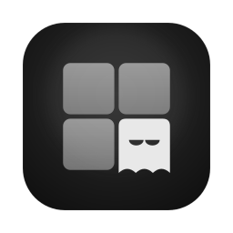

<div align="center">



# Edge glow

**A hairline of light at the top of the screen while an agent waits for you.**

[](https://github.com/highskore/haunt-hackathon)


[](LICENSE)

</div>

While any agent needs you, a thin orange glow breathes along the top edge of the display Haunt's window is on, over every app. At its right end Haunt names the agent that has waited longest, what it wants and for how long: `api · git push? · 2m`. It goes the moment you answer. Under Reduce Motion the glow is steady.

Haunt writes the label itself from its own state of that tab: Edge glow only says which tab, so nothing an agent or its terminal says can end up on your screen this way. Haunt cuts the command short and adds the `?`. To keep commands off your screen, set `label = "count"` or `"none"`.

## Settings

```toml
[plugins."dev.haunt.edge-glow"]
label = "tab"        # "tab": api · git push? · 2m, "count": 2 need you, "none": the glow alone
unverified = false   # also follow events without the tab's nonce
```

## Capabilities

| capability | why |
|---|---|
| `events` (session start, prompt, subagent, tool, permission request, question, stop) | each agent's state |
| `event_details` | lets Haunt show the waiting command in the label; Edge glow never reads it |
| `glow` | the glow itself |
| `timer` | retries a refused show |

Only one plugin owns the glow at a time: if another has it, Edge glow tries again every 15 s. `[plugin_fx] glow = false` in Haunt's config turns plugin glows off, and `glow_label = false` just the label.

## Build and test

```sh
cargo build --release --target wasm32-wasip2   # or ./build.sh
cargo test                                     # unit tests
haunt plugin install .
```

`e2e/edge_glow.rs` runs the built plugin against a real Haunt core: copy it into a Haunt checkout's `cli/tests/` and run `HAUNT_PLUGINS_DIR=<this repo's parent> cargo test -p haunt-cli --features plugins --test edge_glow`.

Needs Haunt with plugin API 0.5 (`api = "0.5"`) and its `glow` import.

## Licence

MIT, see `LICENSE`.
